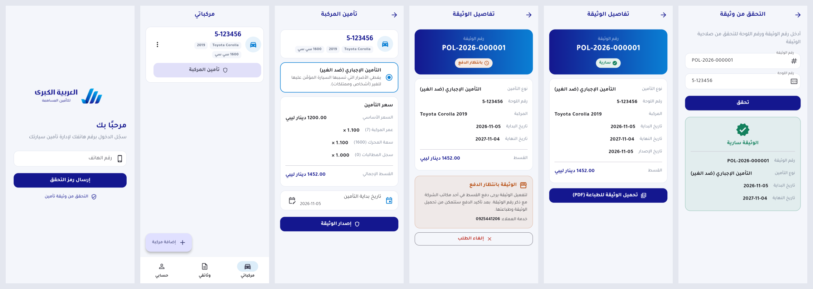

# العربية الكبرى للتأمين المساهمة — Alarabia Kobrah Insurance Company

Car insurance platform (Benghazi, Libya).

A digital car insurance platform. Customers register vehicles, get a quote, pay, download a printable
policy PDF, renew it, and file accident claims. The insurance company manages everything from an admin dashboard.
UI language: Arabic (RTL) first, English second.

## Repository layout

| Folder | App | Status |
|---|---|---|
| [`backend/`](backend/README.md) | Laravel REST API (`/api/v1`) | Phase 1 ✅ |
| [`mobile/`](mobile/README.md) | Flutter customer app (Arabic RTL + English) | Phase 1 ✅ |
| `admin/` | React (Vite) + Tailwind admin dashboard | planned |

## Build phases

1. ✅ Auth (phone + OTP), roles, vehicles, quote engine, policy issuance + PDF download
2. Payments (gateway + office), renewal, scheduled reminders, push notifications
3. Claims, surveyor flow, admin dashboard
4. AI damage classification (FastAPI service), duplicate-image fraud detection, analytics

See [`backend/README.md`](backend/README.md) for the API and [`mobile/README.md`](mobile/README.md) for the app.

