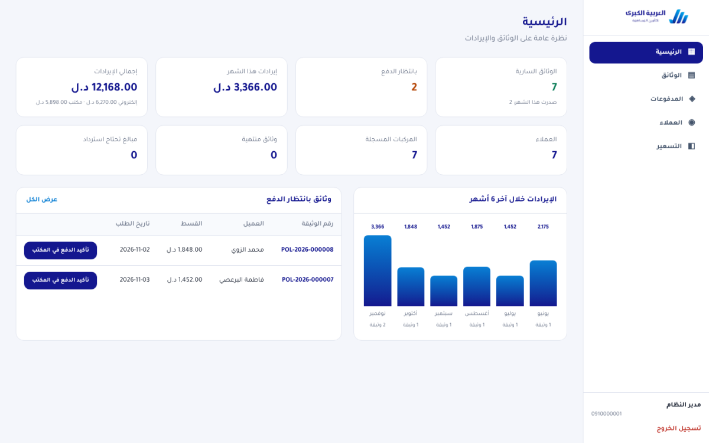

# Admin dashboard (React)

Staff dashboard for **العربية الكبرى للتأمين المساهمة**. It is Arabic-only and right-to-left, and talks to the Laravel API in [`../backend`](../backend/README.md).



## Pages

| Page | What staff can do |
|---|---|
| Login | Phone number and password. Only `admin` accounts can sign in |
| Home (الرئيسية) | Active and pending policies, revenue for the month and in total (online vs. office), customers, refunds needed, a 6-month revenue chart, and a pending-payment list with quick "confirm payment" |
| Policies (الوثائق) | Filter by status, and search by policy number, plate, customer name, phone or national number |
| Policy details | Customer, vehicle, the pricing breakdown at issuance and payment history. Actions: confirm office payment (with receipt number), print the PDF, cancel |
| Payments (المدفوعات) | Online and office payments, filters, and the **requires refund** flag |
| Customers (العملاء) | Search, vehicle and policy counts, document status. Details page shows the ID and license photos (signed links), and a block/unblock button |
| Pricing (التسعير) | Base price per coverage type, enabling coverage types, and the factor bands for vehicle age, engine and claims history. Overlapping bands are rejected and gaps are flagged |

## Run

```bash
npm install
```

```bash
cp .env.example .env
```

```bash
npm run dev
```

Set `VITE_API_BASE_URL` in `.env` to the API, for example `http://127.0.0.1:8000/api/v1`.

The demo admin is `0910000001` with password `password` (seeded outside production). **Change it in production.**

```bash
npm run build
```

This outputs static files in `dist/`. Serve them with any web server, with SPA fallback to `index.html`.

## Checks

```bash
npm run typecheck
```

```bash
npm test
```

## Stack

React 19, React Router 8, TanStack Query 5, Tailwind CSS 4, Vite 8, TypeScript 7. The font is Tajawal (bundled), and the brand colours are the same as the mobile app's.

- `src/lib/api.ts` handles the API envelope, token storage, Arabic error messages, and protected PDF download.
- `src/lib/format.ts` formats money (`1,452.00 د.ل`), dates and month names.
- Amounts are never wrapped in an LTR span, so the currency stays on the left in RTL text. Plates, policy numbers and dates use `.ltr`.
