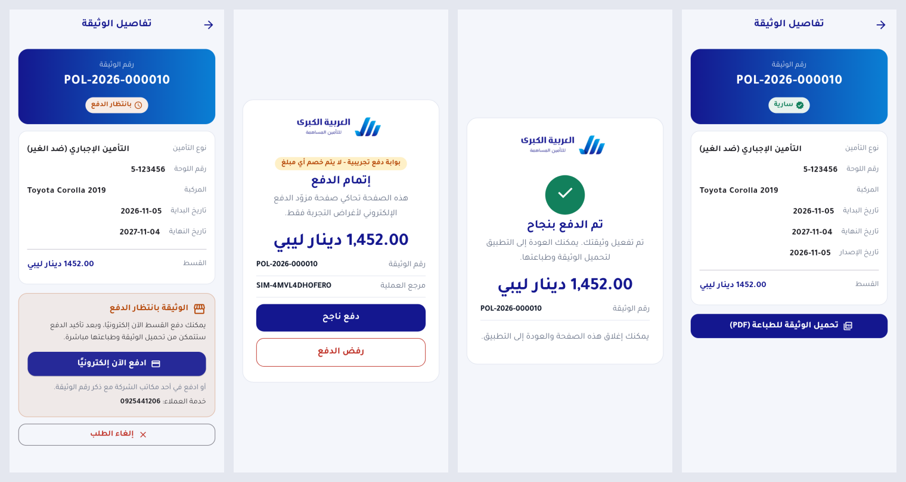
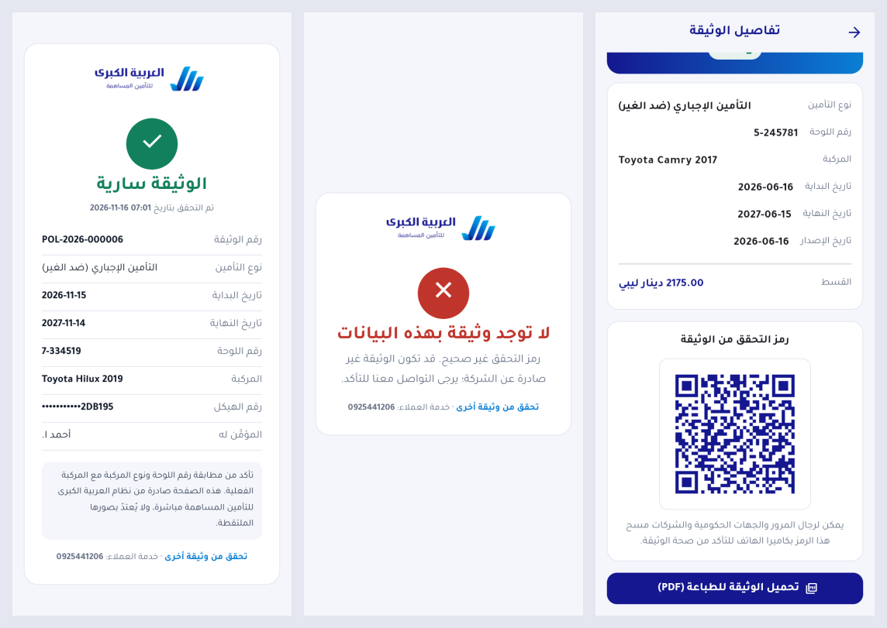
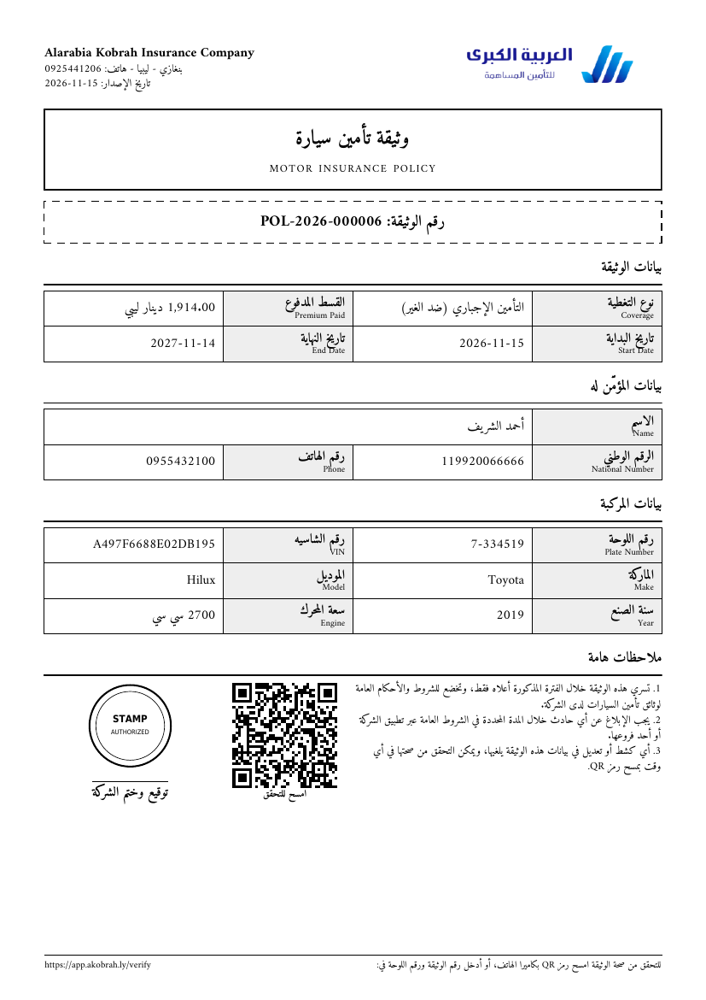

# Car Insurance API (Laravel)

REST API for the insurance platform: customers buy compulsory motor insurance in the app
(quote → pay → printable Arabic PDF with a QR code), and send requests for products that staff price
manually (marine cargo; see Products for the ones switched off).

**Status: Phase 1 complete** — customer accounts (phone + password, SMS code at sign-up), roles, vehicles, quote engine, policy issuance,
office-payment confirmation, PDF download, public policy verification (QR code on every policy).

## Stack

| Concern | Choice |
|---|---|
| Framework | Laravel 12 (same structure as Laravel 11 — see note below) |
| Auth | Laravel Sanctum personal access tokens, phone + password; SMS codes confirm the phone and reset passwords |
| Roles | spatie/laravel-permission (`customer`, `surveyor`, `admin`, `workshop`) |
| PDF | mPDF via `carlos-meneses/laravel-mpdf`, Amiri font (OFL), RTL |
| DB | MySQL in production, SQLite in-memory for tests |
| Queue | `database` driver (PDF generation) |

> **Why Laravel 12 and not 11?** Every Laravel 11.x release is affected by CVE-2026-114509 (critical)
> and is out of security support, so no patched 11.x exists. Laravel 12 keeps the exact
> Laravel 11 application structure (`bootstrap/app.php`, no Kernel classes), so nothing in this
> codebase is version-specific.

## Setup

```bash
cd backend
composer install
cp .env.example .env
php artisan key:generate
```

Create the MySQL database, then set `DB_*` in `.env`:

```sql
CREATE DATABASE akobrah_insurance CHARACTER SET utf8mb4 COLLATE utf8mb4_unicode_ci;
```

```bash
php artisan migrate --seed
php artisan serve
```

```bash
php artisan queue:work   # generates policy PDFs after activation
```

### Demo accounts (seeded outside production)

The customer signs in to the app with password `123456`; staff sign in to the dashboard with `password`.
SMS codes (sign-up, forgotten password): with `OTP_FIXED_CODE=123456` in a **local** `.env` the code is always
`123456`; otherwise it is written to `storage/logs/laravel.log` (the `log` SMS driver).

| Role | Phone |
|---|---|
| admin | 0910000001 |
| surveyor | 0910000002 |
| customer (has a demo vehicle) | 0910000003 |
| workshop | 0910000004 |

## Tests

```bash
php artisan test
```

72 tests: OTP auth, vehicles, **quote calculation**, policy issuance, **policy PDF access control**,
public verification, claim status transitions (enum rules), plate/digit normalization.

## API

Base URL: `/api/v1`. Send `Authorization: Bearer <token>` for protected routes and
`Accept-Language: ar|en` (Arabic is the default).

### Response envelope

```json
{ "success": true,  "message": "تمت إضافة المركبة بنجاح.", "data": { }, "meta": { "pagination": { } } }
{ "success": false, "message": "البيانات المدخلة غير صحيحة.", "errors": { "vin": ["رقم الشاسيه مسجل لمركبة أخرى."] } }
```

| Status | Meaning |
|---|---|
| 401 | missing/invalid token |
| 403 | not your resource / wrong role / policy not active / invalid signed URL |
| 404 | not found |
| 422 | validation error (`errors`) or business rule (e.g. overlapping policy) |
| 429 | rate limited |

### Endpoints

| Method | Path | Auth | Description |
|---|---|---|---|
| POST | `/auth/register` | public | `first_name`, `last_name`, `phone`, `address`, `password` (+ `_confirmation`), `device_name`; 202 + SMS code first, then again with `code` → 201 + `token` |
| POST | `/auth/login` | public, 5/min/phone | Customer `phone` + `password` → `token` |
| POST | `/auth/password/forgot` | public | `phone` → SMS code (same answer whether or not the number is registered) |
| POST | `/auth/password/reset` | public | `phone`, `code`, new `password` → `token`; other devices signed out |
| POST | `/auth/password/change` | any role | `current_password`, new `password`; other devices signed out |
| PATCH | `/me` | customer | `national_id`, `address` (national number + both documents are needed before a policy) |
| GET | `/auth/me` | any role | Current user (document URLs are temporary signed links) |
| POST | `/auth/logout` | any role | Revoke current token |
| GET | `/coverage-types` | public | Active coverage types |
| GET | `/products` | public | Product catalog (localized): `issuance` = `instant` / `request`, covers, documents, request form fields |
| GET | `/company` | public | Company info, branches, about and privacy texts |
| GET | `/policies/verify?policy_no=&plate_no=` | public, 10/min/IP | `VALID` / `EXPIRED` / `NOT_FOUND`, no personal data |
| GET | `/verify` (web) | public | Verification page (form): policy number + plate number |
| GET | `/verify/{policy_no}/{token}` (web) | public, 60/min/IP | Page opened by the **QR code** printed on the policy |
| POST | `/me/documents` | customer | Upload `id_image` and/or `license_image` (multipart) |
| GET | `/vehicles/options` | customer | Form lists: brands (Arabic names), colours, countries of manufacture, licence purposes, licensing authorities, year and seat limits |
| GET/POST | `/vehicles` | customer | List (paginated) / create: owner name and address, plate, VIN, make, model, year, engine, colour, country, licence purpose, seats, licensing authority |
| GET/PATCH/DELETE | `/vehicles/{id}` | owner | Show / update / delete |
| POST | `/quotes` | owner | `vehicle_id`, `coverage_type_id` → premium + factor breakdown (not saved) |
| POST | `/quotes/estimate` | customer | "Know the price": `manufacture_year`, `engine_cc` (compulsory coverage by default) |
| GET/POST | `/persons` | customer | People the customer insures (travellers, family) |
| GET/PUT/DELETE | `/persons/{id}` | owner | Show / replace / delete |
| GET | `/travel/options` | customer | Zones, trip lengths and price per traveller |
| POST | `/quotes/travel` | customer | `zone`, `days`, `travellers` → premium (not saved) |
| POST | `/policies/travel` | customer | `zone`, `days`, `start_date`, `person_ids[]` → `PENDING_PAYMENT` travel policy |
| GET/POST | `/requests` | customer | Requests for staff-handled products (multipart: `product`, `kind`, `answers[...]`, `documents[...]`) |
| GET | `/requests/{id}` | owner/admin | Show |
| POST | `/requests/{id}/cancel` | owner | Withdraw while open |
| GET | `/policies` | customer | Own policies, motor and travel (`?status=ACTIVE&vehicle_id=&product=travel`) |
| POST | `/policies` | owner | Create `PENDING_PAYMENT` policy (`start_date` optional, ≤ 60 days ahead) |
| GET | `/policies/{id}` | owner/admin | Show |
| POST | `/policies/{id}/cancel` | owner | Cancel while `PENDING_PAYMENT` |
| GET | `/policies/{id}/pdf` | owner, `ACTIVE` only | A4 printable PDF |
| POST | `/policies/{id}/pay-online` | owner | Start online payment → `checkout_url` |
| GET | `/payments/{id}` | owner/admin | Payment status (re-checked with the provider while pending) |
| POST | `/payments/webhook/{gateway}` | provider | Server-to-server notification (status is always re-fetched) |
| POST | `/auth/staff/login` | public | Dashboard login (phone + password, staff roles only) |
| GET | `/admin/stats` | admin | Dashboard numbers + 6-month series |
| GET | `/admin/policies` | admin | `?status=&search=` (policy no, plate, name, phone, national number) |
| GET | `/admin/policies/{id}` | admin | Details with customer, payments, pricing snapshot |
| POST | `/admin/policies/{id}/confirm-office-payment` | admin | "Pay at office": records payment, activates policy, queues PDF |
| POST | `/admin/policies/{id}/cancel` | admin | Cancel a pending policy |
| GET | `/admin/policies/{id}/pdf` | admin | Print an active policy at the office |
| GET | `/admin/payments` | admin | `?method=&status=&requires_refund=1` |
| GET/PATCH | `/admin/customers[/{id}]` | admin | Search, details (documents), block/unblock (`is_active`) |
| GET | `/admin/pricing` | admin | Coverage types, factor bands, gap report |
| PATCH | `/admin/coverage-types/{id}` | admin | Base price, active flag, names |
| POST/PUT/DELETE | `/admin/pricing-factors[/{id}]` | admin | Factor bands (overlaps rejected) |
| POST/PATCH | `/admin/travel-rates[/{id}]` | admin | Travel price per traveller by zone and trip length |
| GET | `/admin/requests[/{id}]` | admin | `?status=&product=&search=`; details include signed links to attachments |
| POST | `/admin/requests/{id}/respond` | admin | `status` (IN_REVIEW / QUOTED / COMPLETED / REJECTED), `reply`, `quoted_amount` |

### Sign-up / sign-in flow

```
POST /auth/register  {first_name, last_name, phone, address, password, password_confirmation, device_name}
   → 202 { verification_required: true, expires_in, resend_after }   (SMS code sent)
POST /auth/register  {... same fields ..., code}
   → 201 { token, user }
POST /auth/login     {phone, password, device_name}  → { token, user }
```

Set `AUTH_VERIFY_PHONE=false` to create accounts without the SMS step (only until an SMS provider is
connected: without it anyone could sign up with someone else's number). Accounts created before passwords
existed have none; they use "forgot password" once.

SMS codes are stored as HMAC hashes, expire after 5 minutes, lock after 5 wrong attempts, and are limited
to one a minute and five an hour per phone (20 an hour per IP). Logins are limited to 5 a minute per phone.
Localized for **Libya** (all values in `config/insurance.php` / `.env`):

| Input | Rule |
|---|---|
| Phone | `09[1-4]XXXXXXX` (10 digits, Libyana / Almadar); `+218…`, `00218…`, `9XXXXXXXX` (typed after the app's +218 box), spaces and dashes are converted to the local format |
| National number | 12 digits, starts with 1 or 2 |
| Plate | free format, e.g. `5-123456`; spaces/dashes ignored when comparing |
| Currency | LYD (دينار ليبي) |

Arabic-Indic digits (`٠١٢٣`) are accepted in phone, national number, OTP, plate and year inputs.

### Coverage types

The company currently sells **compulsory third-party insurance only** (`THIRD_PARTY`).
`COMPREHENSIVE` exists in `coverage_types` but is seeded with `is_active = false`; switching it on needs no code change.
Seeded base prices are placeholders until the official tariff is provided.

### Quote engine

```
premium = base_price × vehicle_age_factor × engine_factor × claims_history_factor
```

- Factors live in `pricing_factors` (`factor_type`, inclusive `min_value`..`max_value`, `NULL` max = open-ended).
- `claims_history` = the owner's non-rejected claims across all their vehicles in the last
  `QUOTE_CLAIMS_HISTORY_YEARS` (default 3).
- A value with no matching band returns 422 instead of silently using 1.0.
- The premium is recalculated on `POST /policies` (client values are ignored), and the full
  breakdown is stored in `policies.pricing_snapshot` for audit.

### Policy lifecycle (phase 1)

```
POST /policies → PENDING_PAYMENT ──(admin confirms office payment)──► ACTIVE ──(PDF queued)
                        └──(customer cancels)──► CANCELLED
```

- Policy numbers: `POL-YYYY-000001`, yearly sequence with a row lock (`document_sequences`).
- One pending/active policy per vehicle per period (overlap check).
- KYC (ID + license images) is required before creating a policy.
- If payment is confirmed after the requested start date, coverage starts on the payment day (full term kept).

## Online payments



Providers implement `App\Services\Payments\PaymentGateway`. Hosted-checkout flow (simulator):

```
app  → POST /policies/{id}/pay-online → checkout_url (provider page)
customer pays on the provider page
provider → POST /payments/webhook/{gateway}   (and/or the app polls GET /payments/{id})
server   → fetchStatus() from the provider → PAID → policy ACTIVE → PDF queued
```

- Callback parameters are **never trusted**: the result is always re-fetched from the provider.
- Idempotent: concurrent webhooks and polls are serialized with row locks, so a policy is activated once.
- The amount must match the policy premium, otherwise the payment fails with `amount_mismatch` and is flagged for refund.
- Starting a new attempt closes the previous one (`superseded`). An office payment closes open online attempts (`paid_at_office`).
  If the customer still pays on the provider page, the money is recorded and flagged `requires_refund` instead of being lost.
- **`simulator`** is a built-in fake provider: a signed Arabic page with "دفع ناجح" / "رفض الدفع" buttons, used for development and demos.
  It is disabled when `APP_ENV=production` (`PAYMENT_SIMULATOR_ENABLED`).

### SMS codes — Resala (resala.ly)

Sign-up and forgotten-password codes go through an `OtpSender` chosen by `SMS_DRIVER`:

| Driver | What happens |
|---|---|
| `log` (default) | The code is generated here and written to `storage/logs/laravel.log` (`OTP_FIXED_CODE` works locally) |
| `resala` | `POST /pins` on Resala: Resala generates the code, texts it ("رمز التحقق: 482913 - العربية الكبرى للتأمين") and returns it; only its hash is stored |

```
SMS_DRIVER=resala
RESALA_API_KEY=rsl_...            # dashboard → الربط البرمجي API; never commit it
RESALA_SENDER=Alarabia            # a name approved under أسماء المرسل (exact case); empty = account default
RESALA_TEST=false                 # true: nothing sent or charged, the code is written to the log
```

`App\Services\Sms\Resala\ResalaClient` has one typed method per call: `sendPin()` (`/pins`),
`sendTemplate()` (`/messages/send-template`) and `sentMessages()` (`/sent-view`). Errors are a
`ResalaException` whose `type` mirrors Resala's `type` field (`AccountExpired`, `InsufficientCredit`,
`BadRequest`, `Unauthorized`, `TokenExpired`, `Forbidden`, `NotFound`, `InputValidation` with per-field
`errors`, plus `Unknown` and `ConnectionFailed`). Sends are never retried, since the message may already
have gone out.

For customers: a number Resala cannot text is a form error on the phone; any other failure answers 503
"try again later", and account problems (no credit, expired, bad key) are logged as **critical** so the
company tops up or renews. Phone numbers are limited to 091–094 (Libyana, Almadar): the numbers Resala texts.

### DPAY (dpay.ly) — OTP flow

DPAY gives one API for Libyan wallets and bank apps (Edfali, Sadad, MobiCash, Moamalat, YousrPay,
MasrefyPay, SaharaPay, MPGS cards). There is no hosted page: the customer types their phone number and
the code they receive **inside our app** (`App\Services\Payments\DpayGateway`, `OtpPaymentGateway`).

```
app    → GET  /payments/options                    flow=otp, methods (edfali, ...)
app    → POST /policies/{id}/pay-online             phone, pay_method
server → POST {dpay}/payment/sessions/open          → session_id (stored in gateway_ref); the customer gets a code
app    → POST /payments/{id}/confirm                otp (5 tries/min per payment)
server → POST {dpay}/payment/sessions/verify        then GET {dpay}/payment/sessions/{id} (source of truth)
dpay   → POST /payments/webhook/dpay                 X-Dpay-Signature = hex HMAC-SHA256(raw body); unsigned → ignored
```

| `.env` | |
|---|---|
| `PAYMENT_GATEWAY=dpay` | use DPAY instead of the simulator |
| `DPAY_SANDBOX=true` | test token (`sb_tk_...`) on `/api/sandbox/...`; set `false` with a live token |
| `DPAY_API_TOKEN` | from the DPAY dashboard → API tokens (**never commit it**) |
| `DPAY_WEBHOOK_SECRET` | from the DPAY dashboard → server notifications |
| `DPAY_PAY_METHODS=edfali` | methods connected in the DPAY dashboard, comma separated |

Sandbox codes: `111111` settles, `000000` declines. Method limits (LYD) are in `config/payments.php` → `methods`.
Live paths are assumed to be the sandbox paths without `/sandbox` (`DPAY_API_PREFIX` overrides); session status
names are matched case-insensitively (`paid`, `settled`, `completed`... / `failed`, `declined`, `expired`...) and the
raw session is kept in `payments.gateway_payload`.

**Adding another provider:** implement `PaymentGateway` (or `OtpPaymentGateway`), register it in
`PaymentGatewayManager::GATEWAYS` and `config/payments.php`, then set `PAYMENT_GATEWAY` and its webhook URL
`https://<api-host>/api/v1/payments/webhook/<name>`.

## Admin dashboard

Staff sign in at `POST /auth/staff/login` with phone + password (the demo admin is `0910000001` / `password`, seeded outside production).
The React dashboard lives in [`../admin`](../admin/README.md).

## Public verification (QR code)



Every issued policy carries a QR code, on the printed PDF and on the policy screen in the app. Traffic police, government
bodies and companies scan it with any phone camera, with no app or account, and land on the company's official page:

- The status is shown in large type: **سارية** (valid), **منتهية** (expired), **ملغاة** (cancelled) or **غير مفعّلة** (not active).
  It also shows the policy number, coverage, dates, plate and vehicle, the last 6 characters of the VIN and a masked
  name (`محمد أ. ع.`), so the inspector can compare them with the car in front of them.
- **Forgery-resistant:** the QR link is `/verify/{policy_no}/{token}`, where the token is an HMAC-SHA256 of the policy
  number with a server secret. A made-up or altered link gets "لا توجد وثيقة بهذه البيانات" (no policy matches these details).
  A QR copied from another policy shows *that* policy's vehicle, which won't match the car.
- The page is always live (`Cache-Control: no-store`) and shows the check time, so screenshots carry no weight.
- Without a QR, the `/verify` form accepts a policy number and plate number. It shows validity but not the holder's name.

Configuration (`.env`):

| Key | Purpose |
|---|---|
| `POLICY_VERIFICATION_URL` | Public HTTPS address of this app's `/verify` page, e.g. `https://app.akobrah.ly/verify`. It is printed in the QR, so set it before issuing real policies |
| `POLICY_VERIFICATION_SECRET` | Signs the QR tokens. Generate once (`openssl rand -hex 32`) and **never change it**, or printed QR codes stop verifying. Falls back to `APP_KEY` |

The QR code is drawn by mPDF (`mpdf/qrcode`, error correction M). It is tested to decode from the rendered PDF down to 50 dpi.

## Policy PDF



- Template: `resources/views/pdf/policy.blade.php` (single A4 page, RTL, Amiri, colour logo, signed verification QR code).
- Logo: `resources/pdf/logo.png` (colour, by company choice; the rest of the page is black & white).
  The stamp is still a placeholder (`resources/pdf/stamp.svg`); override paths with `COMPANY_LOGO_PATH` / `COMPANY_STAMP_PATH`.
- Stored on the private disk at `storage/app/private/policies/{year}/{policy_no}.pdf`; generated by a
  queued job, or on first download if the worker hasn't run yet.
- mPDF notes: don't use CSS `size:` in `@page` (it breaks pagination). Wrap Latin text or dates that sit
  next to Arabic text in `<bdo dir="ltr">`. Amiri **0.113** is bundled because newer Amiri builds use
  GPOS lookups that mPDF cannot parse.

## Products

Defined in `config/products.php` (structure) and `lang/{ar,en}/products.php` (text).
Only the products listed in `offered` are shown and accepted; currently **motor** and **marine cargo**.
The others stay in the code but are switched off: hidden from `/products`, request submissions for
them fail validation, and their routes (`/persons`, `/travel/*`, `/admin/travel-rates`) answer 404.
Adding a code back to `offered` switches it on again (the app and dashboard follow the catalog).

| Product | Offered | Issuance | Flow |
|---|---|---|---|
| `motor` | yes | instant | vehicle → quote → policy → payment → PDF + QR |
| `marine_cargo` | yes | request | form + attachments → staff reply (price offer / completed / rejected) |
| `travel` | no | instant | zone + trip length + saved persons → policy → payment → PDF + QR |
| `orange_card`, `foreign_workers`, `medical_liability` | no | request | same as marine cargo |

Policies belong to the customer (`policies.user_id`); `vehicle_id` / `coverage_type_id` are set for motor,
`travel_zone` / `travel_days` and `policy_travellers` (snapshot of names and passports) for travel.
Travel prices (`travel_rates`) are placeholders until the company's tariff is entered from the dashboard.

## Project layout

```
app/
  Enums/                 PolicyStatus, ClaimStatus (with transition rules), UserRole, ...
  Exceptions/            BusinessRuleException, ApiExceptionRenderer (JSON + Arabic messages)
  Http/
    Controllers/Api/V1/  Auth, Vehicle, Quote, Policy, PolicyVerification, Admin/PolicyPayment, File
    Middleware/          ForceJsonResponse, SetLocale
    Requests/            Form requests (digit normalization in ApiRequest)
    Resources/           JSON resources
    Responses/ApiResponse.php
  Jobs/GeneratePolicyPdf.php
  Models/                User, Vehicle, CoverageType, PricingFactor, Policy, PolicyTraveller, TravelRate,
                         InsuredPerson, InsuranceRequest(+Document), Payment, Claim, ClaimMedia,
                         Inspection, ClaimStatusLog, Workshop, NotificationLog, OtpCode
  Policies/              VehiclePolicy, PolicyPolicy (authorization)
  Services/              Auth/OtpService, Auth/AuthService, Pricing/QuoteService, Pricing/TravelQuoteService,
                         Catalog/ProductCatalog, Requests/InsuranceRequestService,
                         Policy/PolicyService, Policy/PolicyPdfService, Policy/PolicyVerificationService,
                         DocumentNumberGenerator, UserDocumentService, Sms/*
config/insurance.php     All business settings (currency, OTP, regexes, upload limits, company info, branches)
config/products.php      Product catalog structure (issuance mode, request form fields, documents)
lang/{ar,en}/            messages, enums, products, company (about/privacy drafts), travel, validation (ar)
```

## Next phases

- **Phase 2**: ✅ online payments (simulator, real provider pending) and admin dashboard. Still to do: renewal
  (`previous_policy_id`), expiry job, reminders 30/7/1 days before expiry (scheduler + FCM), `notifications_log`.
- **Phase 3**: claims API (media upload with `image_hash`, other-party linking, status workflow and
  `claim_status_logs`), surveyor flow, admin dashboard endpoints and stats.
