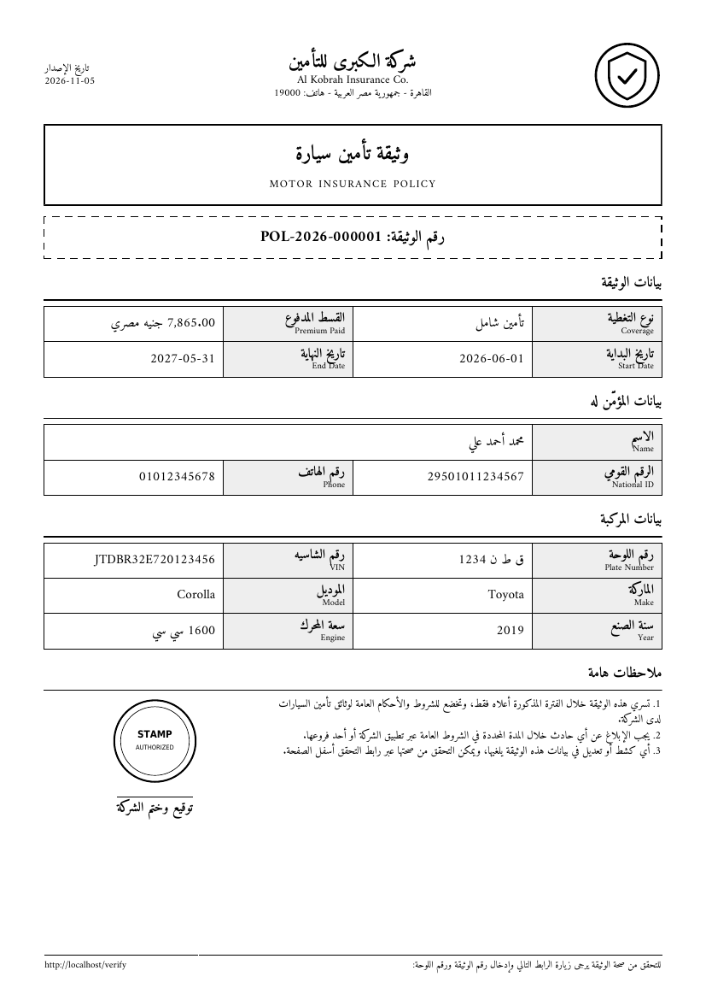

# Car Insurance API (Laravel)

REST API for the car insurance platform: customers register vehicles, get quotes, buy policies,
download a printable Arabic PDF, and (later phases) renew and file claims.

**Status: Phase 1 complete** — auth (phone + OTP), roles, vehicles, quote engine, policy issuance,
office-payment confirmation, PDF download, public policy verification.

## Stack

| Concern | Choice |
|---|---|
| Framework | Laravel 12 (same structure as Laravel 11 — see note below) |
| Auth | Laravel Sanctum personal access tokens, phone + OTP |
| Roles | spatie/laravel-permission (`customer`, `surveyor`, `admin`, `workshop`) |
| PDF | mPDF via `carlos-meneses/laravel-mpdf`, Amiri font (OFL), RTL |
| DB | MySQL in production, SQLite in-memory for tests |
| Queue | `database` driver (PDF generation) |

> **Why Laravel 12 and not 11?** Every Laravel 11.x release is affected by CVE-2026-114509 (critical)
> and is out of security support, so no patched 11.x exists. Laravel 12 keeps the exact
> Laravel 11 application structure (`bootstrap/app.php`, no Kernel classes), so nothing in this
> codebase is version-specific.

## Setup

```bash
cd backend
composer install
cp .env.example .env
php artisan key:generate
```

Create the MySQL database, then set `DB_*` in `.env`:

```sql
CREATE DATABASE car_insurance CHARACTER SET utf8mb4 COLLATE utf8mb4_unicode_ci;
```

```bash
php artisan migrate --seed
php artisan serve
```

```bash
php artisan queue:work   # generates policy PDFs after activation
```

### Demo accounts (seeded outside production)

All accounts log in with OTP. With `OTP_FIXED_CODE=123456` in a **local** `.env`, the code is always `123456`;
otherwise the code is written to `storage/logs/laravel.log` (the `log` SMS driver).

| Role | Phone |
|---|---|
| admin | 01000000001 |
| surveyor | 01000000002 |
| customer (has a demo vehicle) | 01000000003 |
| workshop | 01000000004 |

## Tests

```bash
php artisan test
```

72 tests: OTP auth, vehicles, **quote calculation**, policy issuance, **policy PDF access control**,
public verification, claim status transitions (enum rules), plate/digit normalization.

## API

Base URL: `/api/v1`. Send `Authorization: Bearer <token>` for protected routes and
`Accept-Language: ar|en` (Arabic is the default).

### Response envelope

```json
{ "success": true,  "message": "تمت إضافة المركبة بنجاح.", "data": { }, "meta": { "pagination": { } } }
{ "success": false, "message": "البيانات المدخلة غير صحيحة.", "errors": { "vin": ["رقم الشاسيه مسجل لمركبة أخرى."] } }
```

| Status | Meaning |
|---|---|
| 401 | missing/invalid token |
| 403 | not your resource / wrong role / policy not active / invalid signed URL |
| 404 | not found |
| 422 | validation error (`errors`) or business rule (e.g. overlapping policy) |
| 429 | rate limited |

### Endpoints

| Method | Path | Auth | Description |
|---|---|---|---|
| POST | `/auth/otp/send` | public, 1/min/phone | Send OTP SMS |
| POST | `/auth/otp/verify` | public | Existing user → `token`; new phone → `registration_token` |
| POST | `/auth/register` | public | `registration_token`, `name`, `national_id`, `device_name`, optional `id_image`, `license_image` |
| GET | `/auth/me` | any role | Current user (document URLs are temporary signed links) |
| POST | `/auth/logout` | any role | Revoke current token |
| GET | `/coverage-types` | public | Active coverage types |
| GET | `/policies/verify?policy_no=&plate_no=` | public, 10/min/IP | `VALID` / `EXPIRED` / `NOT_FOUND`, no personal data |
| POST | `/me/documents` | customer | Upload `id_image` and/or `license_image` (multipart) |
| GET/POST | `/vehicles` | customer | List (paginated) / create |
| GET/PATCH/DELETE | `/vehicles/{id}` | owner | Show / update / delete |
| POST | `/quotes` | owner | `vehicle_id`, `coverage_type_id` → premium + factor breakdown (not saved) |
| GET | `/policies` | customer | Own policies (`?status=ACTIVE&vehicle_id=`) |
| POST | `/policies` | owner | Create `PENDING_PAYMENT` policy (`start_date` optional, ≤ 60 days ahead) |
| GET | `/policies/{id}` | owner/admin | Show |
| POST | `/policies/{id}/cancel` | owner | Cancel while `PENDING_PAYMENT` |
| GET | `/policies/{id}/pdf` | owner, `ACTIVE` only | A4 printable PDF |
| POST | `/admin/policies/{id}/confirm-office-payment` | admin | "Pay at office": records payment, activates policy, queues PDF |

### Login / registration flow

```
POST /auth/otp/send     {phone}
POST /auth/otp/verify   {phone, code, device_name}
   ├─ existing user → { is_new_user: false, token, user }
   └─ new phone     → { is_new_user: true, registration_token (30 min, single use) }
POST /auth/register     {registration_token, name, national_id, device_name, id_image?, license_image?}
   → { token, user }
```

OTP codes are stored as HMAC hashes, expire after 5 minutes, and lock after 5 wrong attempts.
Arabic-Indic digits (`٠١٢٣`) are accepted in phone, national ID, OTP, plate and year inputs.

### Quote engine

```
premium = base_price × vehicle_age_factor × engine_factor × claims_history_factor
```

- Factors live in `pricing_factors` (`factor_type`, inclusive `min_value`..`max_value`, `NULL` max = open-ended).
- `claims_history` = the owner's non-rejected claims across all their vehicles in the last
  `QUOTE_CLAIMS_HISTORY_YEARS` (default 3).
- A value with no matching band returns 422 instead of silently using 1.0.
- The premium is recalculated on `POST /policies` (client values are ignored), and the full
  breakdown is stored in `policies.pricing_snapshot` for audit.

### Policy lifecycle (phase 1)

```
POST /policies → PENDING_PAYMENT ──(admin confirms office payment)──► ACTIVE ──(PDF queued)
                        └──(customer cancels)──► CANCELLED
```

- Policy numbers: `POL-YYYY-000001`, yearly sequence with a row lock (`document_sequences`).
- One pending/active policy per vehicle per period (overlap check).
- KYC (ID + license images) is required before creating a policy.
- If payment is confirmed after the requested start date, coverage starts on the payment day (full term kept).

## Policy PDF



- Template: `resources/views/pdf/policy.blade.php` (single A4 page, black & white, RTL, Amiri).
- Replace the placeholder logo and stamp with real assets through `COMPANY_LOGO_PATH` / `COMPANY_STAMP_PATH`.
- Stored on the private disk at `storage/app/private/policies/{year}/{policy_no}.pdf`; generated by a
  queued job, or on first download if the worker hasn't run yet.
- mPDF notes: don't use CSS `size:` in `@page` (it breaks pagination). Wrap Latin text or dates that sit
  next to Arabic text in `<bdo dir="ltr">`. Amiri **0.113** is bundled because newer Amiri builds use
  GPOS lookups that mPDF cannot parse.

## Project layout

```
app/
  Enums/                 PolicyStatus, ClaimStatus (with transition rules), UserRole, ...
  Exceptions/            BusinessRuleException, ApiExceptionRenderer (JSON + Arabic messages)
  Http/
    Controllers/Api/V1/  Auth, Vehicle, Quote, Policy, PolicyVerification, Admin/PolicyPayment, File
    Middleware/          ForceJsonResponse, SetLocale
    Requests/            Form requests (digit normalization in ApiRequest)
    Resources/           JSON resources
    Responses/ApiResponse.php
  Jobs/GeneratePolicyPdf.php
  Models/                User, Vehicle, CoverageType, PricingFactor, Policy, Payment, Claim, ClaimMedia,
                         Inspection, ClaimStatusLog, Workshop, NotificationLog, OtpCode
  Policies/              VehiclePolicy, PolicyPolicy (authorization)
  Services/              Auth/OtpService, Auth/AuthService, Pricing/QuoteService,
                         Policy/PolicyService, Policy/PolicyPdfService, Policy/PolicyVerificationService,
                         DocumentNumberGenerator, UserDocumentService, Sms/*
config/insurance.php     All business settings (currency, OTP, regexes, upload limits, company info)
lang/{ar,en}/            messages, enums, validation (ar)
```

## Next phases

- **Phase 2**: online payment gateway behind a `PaymentGateway` interface, renewal (`previous_policy_id`),
  expiry job, reminders 30/7/1 days before expiry (scheduler + FCM), `notifications_log`.
- **Phase 3**: claims API (media upload with `image_hash`, other-party linking, status workflow and
  `claim_status_logs`), surveyor flow, admin dashboard endpoints and stats.
