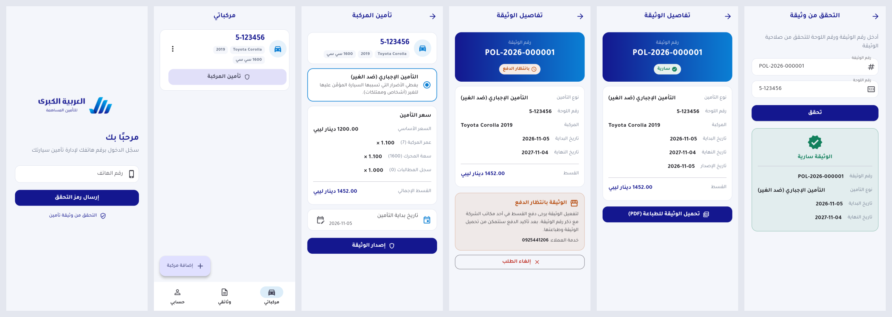

# Customer app (Flutter)

Customer mobile app for **العربية الكبرى للتأمين المساهمة**. Arabic (RTL) is the primary language and English is secondary.
It talks to the Laravel API in [`../backend`](../backend/README.md).



## Features (phase 1)

| Screen | What it does |
|---|---|
| Login | Phone number → SMS code. `+218…`, spaces and Arabic digits are accepted |
| Registration | Name and national number, plus optional ID and license photos (camera or gallery) |
| My vehicles | List, add, edit and delete vehicles; "Insure vehicle" button |
| Insure | Shows the price breakdown from the server, lets the customer pick a start date, then issues the policy |
| My policies | Policies with their status (awaiting payment, active, expired, cancelled) |
| Policy details | **Pay online** (provider page in an in-app browser, status re-checked when the customer returns) or pay at the office; cancel the request; download the PDF and open it to print or share |
| Account | Personal data, document upload, Arabic/English switch, logout |
| Verify a policy | Public check by policy number and plate number. No login needed |

## Run

```bash
flutter pub get
```

Android emulator, with the API on the same machine (`php artisan serve`):

```bash
flutter run
```

Real device or production server:

```bash
flutter run --dart-define=API_BASE_URL=https://api.example.ly/api/v1
```

Release builds:

```bash
flutter build apk --release --dart-define=API_BASE_URL=https://api.example.ly/api/v1
```

```bash
flutter build ipa --release --dart-define=API_BASE_URL=https://api.example.ly/api/v1
```

Plain `http://` is allowed only in Android **debug** builds (`src/debug/AndroidManifest.xml`) and for local networking on iOS. Release builds need an HTTPS API.

## Tests

```bash
flutter analyze
```

```bash
flutter test
```

The tests cover phone normalization, API error mapping, the router auth redirects, JSON models, and the login flow as widget tests with fake repositories.

## Structure

```
lib/
  main.dart / app.dart        ProviderScope, MaterialApp.router, theme, locale
  core/
    api/                      ApiClient (dio): auth + Accept-Language headers, ApiException mapping
    config.dart               API_BASE_URL (--dart-define), customer service number
    router.dart               go_router + auth redirect (authRedirect is unit-tested)
    storage.dart              token in flutter_secure_storage (SessionStore)
    locale_controller.dart    ar/en, persisted
    theme.dart                brand colours from the logo, Tajawal font
  features/
    auth/                     OTP login, registration, AuthController (AsyncNotifier)
    vehicles/                 list, form, repository
    policies/                 insure (quote), list, details, PDF download (pdf_saver_io / stub)
    profile/                  account, documents, language
    verify/                   public policy verification
  l10n/                       app_ar.arb (template), app_en.arb, generated/
```

- **State:** Riverpod 3 (`AsyncNotifier`, `FutureProvider`). Per-user data refetches when the signed-in user changes.
- **Errors:** server messages are already localized (`Accept-Language`). Field errors are shown under the matching input.
- **Bidi:** plate numbers, policy numbers and dates are rendered LTR inside the RTL layout. Mixed Arabic and Latin values are split into separate widgets so the bidi algorithm doesn't reorder them.
- **Fonts:** Tajawal (SIL OFL), bundled in `assets/fonts`.
