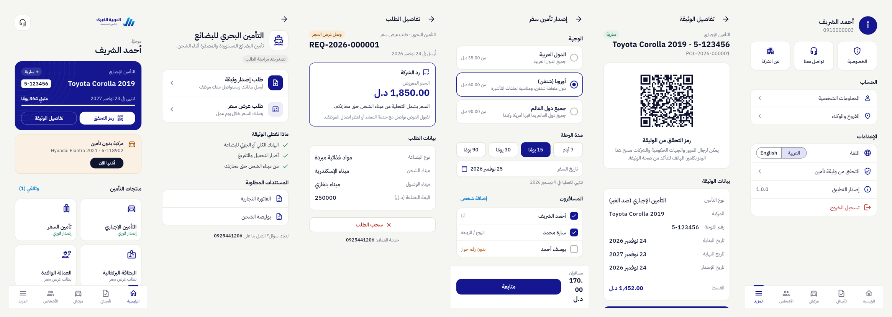

# Customer app (Flutter)

Customer mobile app for **العربية الكبرى للتأمين المساهمة**. Arabic (RTL) is the primary language and English is secondary.
It talks to the Laravel API in [`../backend`](../backend/README.md).



## Screens

Five tabs: **Home · My insurance · Vehicles · People · More**.

| Screen | What it does |
|---|---|
| Login | Phone number → SMS code. `+218…`, spaces and Arabic digits are accepted |
| Registration | Name and national number, plus optional ID and license photos (camera or gallery) |
| Home | Current policy card (expiry, days left, QR), reminder for uninsured vehicles, all products, quick tools |
| Product | What it covers, required documents, and two actions: **issue a policy / know the price** (request products: **request a policy / request a price offer**) |
| Compulsory (motor) | Step 1 vehicle + start date → step 2 policy data + server price breakdown → policy created, step 3 payment on the policy page. Price calculator by manufacture year and engine size |
| Travel | Destination zone, trip length, travel date and travellers (from People) → review → policy created → payment. Calculator by zone, trip length and number of travellers |
| Request form | Built from the product's fields sent by the API (text, number, date, vehicle), notes and photo attachments |
| My insurance | Policies (all / active) and requests with their status; request details show the company's reply and price offer |
| Policy details | **Pay online** (provider page, status re-checked when the customer returns) or at the office; cancel; PDF download; **verification QR code** |
| Vehicles | Vehicles with their insurance status, "Insure it now", edit / delete |
| People | The customer and family members (passport needed for travel) |
| More | Personal information and documents, branches and agents, contact, about, privacy, language, policy verification, logout |
| Verify a policy | Public check by policy number and plate number. No login needed |

## Run

```bash
flutter pub get
```

Android emulator, with the API on the same machine (`php artisan serve`):

```bash
flutter run
```

Real device or production server:

```bash
flutter run --dart-define=API_BASE_URL=https://api.example.ly/api/v1
```

Release builds:

```bash
flutter build apk --release --dart-define=API_BASE_URL=https://api.example.ly/api/v1
```

```bash
flutter build ipa --release --dart-define=API_BASE_URL=https://api.example.ly/api/v1
```

Plain `http://` is allowed only in Android **debug** builds (`src/debug/AndroidManifest.xml`) and for local networking on iOS. Release builds need an HTTPS API.

## Tests

```bash
flutter analyze
```

```bash
flutter test
```

The tests cover phone normalization, API error mapping, the router auth redirects, JSON models (policies, products, requests, people), date and money formatting, and widget tests with fake repositories (login flow, travel form totals and the passport rule).

## Structure

```
lib/
  main.dart / app.dart        ProviderScope, MaterialApp.router, theme, locale
  core/
    api/                      ApiClient (dio): auth + Accept-Language headers, ApiException mapping
    config.dart               API_BASE_URL (--dart-define), customer service number, app version
    router.dart               go_router + auth redirect (authRedirect is unit-tested)
    storage.dart              token in flutter_secure_storage (SessionStore)
    locale_controller.dart    ar/en, persisted
    theme.dart                palette (navy on warm off-white), IBM Plex Sans Arabic
  shared/
    ui.dart                   design-system widgets: StatusPill, OptionTile, CheckRow, ChoiceChips,
                              StepHeader, BottomActionBar, ListGroup/NavRow, NoticeBanner, PriceCard...
    widgets.dart              AsyncView, Error/Empty views, InfoRow, SectionCard, dialogs
    formatters.dart           dates ("14 نوفمبر 2027"), money ("1,452.00 د.ل"), masking
  features/
    auth/                     OTP login, registration, AuthController (AsyncNotifier)
    home/                     tab shell + bottom navigation, dashboard
    catalog/                  products and company info from the API, product page
    motor/                    compulsory insurance: issue (vehicle), review, price calculator
    travel/                   travel insurance: trip + travellers, review, price calculator
    requests/                 dynamic request form, details, list tile
    policies/                 My insurance tab, policy tile, details (payment, QR, PDF)
    vehicles/                 list with insurance status, form, repository
    persons/                  people list and form
    more/                     More tab, personal info and documents, branches, contact, about, privacy
    verify/                   public policy verification
  l10n/                       app_ar.arb (template), app_en.arb, generated/
```

- **State:** Riverpod 3 (`AsyncNotifier`, `FutureProvider`). Per-user data refetches when the signed-in user changes; catalog texts refetch when the language changes.
- **Server-driven catalog:** product names, descriptions, covers, documents and request form fields come from `GET /products`, so new questions don't need an app update.
- **Errors:** server messages are already localized (`Accept-Language`). Field errors are shown under the matching input.
- **Bidi:** plate numbers, policy numbers and phone numbers are rendered LTR inside the RTL layout. Dates are written with Arabic month names and Western digits.
- **Fonts:** IBM Plex Sans Arabic (SIL OFL 1.1), bundled in `assets/fonts`.
